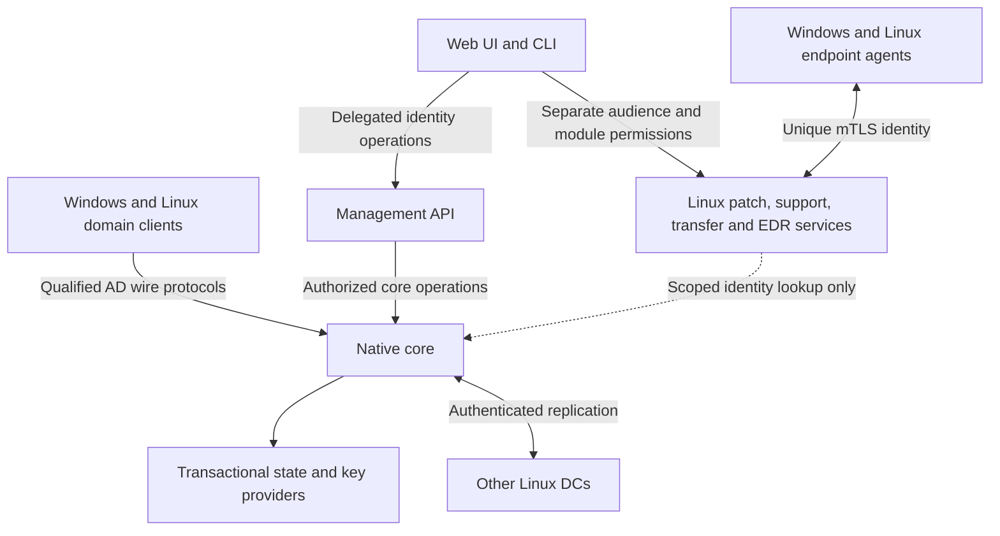

# System design baseline

Status: reviewable native-core design with an initial bounded LDAP lab implementation;
production behavior is not qualified. See [progress](phase-01-progress.md). The owner selected a native AD-compatible core. All 18 detailed
[phase specifications](phases/README.md) refine this design and the
[requirements](requirements.md). Library/database/toolchain decisions not yet
experimentally justified are tracked in [decisions](decisions.md), not hidden
behind claims of completed architecture.

## Product boundary and host contract

Babel owns the identity model, authorization, protocol integration, durable
state and replication behavior. No Samba AD DC daemon, database or administration
tool is required in production. Reviewed cryptographic/TLS/storage/protocol
libraries remain allowed; writing new cryptography or a database engine is not
a project objective. A native implementation owns its integrated security and
conformance burden even when libraries are reused.

Server baseline: Linux x86-64, initially Ubuntu Server 24.04 LTS with systemd on
VMs/physical hosts; exact packages/kernel must be qualified. Windows/Linux clients
and agents have separate support matrices. The owner-selected initial domain/forest
functional level is 2016, with explicit Windows, Linux and macOS identity clients
in the [Phase 0 matrix](phase-00-progress.md); exact builds remain unqualified. Windows reference servers exist only
in licensed isolated test/coexistence scenarios. No Windows Server runtime,
Kubernetes cluster, all-OS server hosting or universal client compatibility is
implicitly required. ARM64/macOS/mobile extensions need separate qualification.

## Components, authority and interfaces

| Component | Responsibility and interface | Authority boundary |
| --- | --- | --- |
| Native directory/domain core | LDAP/GC, Kerberos/PAC, AD DNS, SMB/RPC/Netlogon, schema/FSMO, GPO and replication through qualified wire profiles | Sole directory security-state mutation authority; every operation authenticates/authorizes before the atomic store path |
| Store/key providers | Transactional objects/journal/checkpoints and reviewed credential encryption/key operations | Internal typed core interfaces; no generic management read/write access to secret records |
| Management API/CLI | Versioned HTTPS or permissioned local-socket operations, delegated jobs and explicit high-risk approvals | Uses narrowly scoped core operations; no direct database writer or blanket replication/password-read identity |
| Web administration | Accessible UI, policy/diff/permission previews and actionable audit-correlated errors | Browser never receives DC/service secrets; short sessions, CSRF protection, MFA/step-up and equivalent API RBAC |
| Operations services | Health/audit export, signed updates, coherent backup and isolated restore | Recovery/signing/backup custody separate from routine domain administration; collection cannot become credential export |
| Identity/federation/posture modules | Scoped issuers/connectors, certificate policy and observation-based decisions | Authenticate external claims and restrict who may grant privilege; failed/stale providers do not silently grant access |
| Endpoint registry/patch controller | Unique device enrollment, inventory, trusted catalog and approved package campaigns | Typed expiring jobs and native package executors; no general shell or domain-admin credential |
| Support broker/file delivery | Scoped consented desktop/terminal sessions and separate authenticated file uploads | Session/elevation/recording/upload/retrieval are separate permissions; upload does not execute |
| EDR ingestion/rules/response | Supported OS telemetry, bounded rules, case evidence and approved containment | Sensor, rule publisher and responder separated; a detection is not unlimited fleet execution authority |
| Site relays | Authenticated cache/session/telemetry forwarding under quotas | Content/transit possession cannot mint job approvals, device identities or signing trust |

Proposed implementation: Rust for the native protocol/state integration and its
initial management service, TypeScript for a future browser UI, Python for lab
orchestration/tooling. Consider Go only when its agent/service advantages justify
another maintained toolchain; Rust sensor components and platform bindings need
OS-specific reviews. Rust 1.100.0 is now qualified only for the initial lab slice in
[ADR 0001](adr/0001-native-ldap-lab.md); broader choices still require D-03 review; current Python CI does not select the server
language. Avoid introducing several server languages before a measured need.

Wire compatibility is qualified independently of language. Version internal APIs
and public management contracts; do not invent incompatible extensions to AD
protocols to simplify implementation. Operator APIs return request/correlation ID,
authorization result, state/job version and freshness where applicable, with
bounded pagination and idempotency for asynchronous actions.

## Interface topology

Every box is a trust/authorization boundary, not necessarily one process or one
machine. The topology does not authorize an endpoint service to read raw secrets,
write the core store, or reuse another module's execution permissions.

## Data model and consistency contracts

The owner selected PostgreSQL as the initial backend.
[ADR 0003](adr/0003-postgresql-directory-state.md) defines the proposed local
transaction/journal boundary and remaining qualifications. Each DC owns independent
state; PostgreSQL replication is not the domain replication protocol.

| Entity | Required semantics and lifecycle |
| --- | --- |
| Directory object | Immutable GUID and applicable SID; normalized DN, schema/attribute versions, security descriptor, group links and deletion/tombstone state; renames preserve identity |
| Credential/principal | Opaque protocol-required verifier/key representations, algorithm/version, custody/rotation epoch and authorized consumers; encrypt at rest, never generic attribute export or plaintext persistence |
| Policy | Directory policy object and staged SYSVOL artifact/ACL/version linked by recoverable transition; reconcile partial failures without claiming cross-store atomicity that does not exist |
| Replica | Origin/invocation identity, local progress/cursors, object/attribute metadata, naming contexts, topology/FSMO and restore epoch; map to selected AD wire semantics |
| Device | Unique revocable enrollment identity, optional directory computer link, platform/build/agent version and timestamped inventory; hostname/tag is not authentication |
| Job/approval | Immutable approved actor/target/content/destination scope, expiry, replay/idempotency key, attempt generation and requested/approved/scheduled/running/verified/failed/cancelled/unknown state |
| Session | Operator/device identity, permitted channels, consent/approval, expiry, reconnect binding and auditable termination; unattended access separately enabled |
| Blob/transfer | Authenticated digest/size/source, target/path/overwrite policy, bounded offsets, staging/verification receipts and cleanup deadline; file presence is not approval |
| Telemetry/case | Device/boot/process generation, sequence, observation time, source/rule version, known gaps and scoped evidence custody; missing observations remain unknown |
| Evidence/exception | Requirement/test/commit/platform, expected/actual result, outcome, artifacts, owner and disposition; exceptions have scope/expiry and never silently rewrite baseline requirements |

Local mutation success means the documented transaction and journal are durable
on that DC, not that every site has converged. Atomic object/attribute state and
replication progress must be recoverable. Define exact durability boundaries and
fsync/crash guarantees before fixing a format. Map conflict/version/deletion and
RID/FSMO allocation invariants before multi-controller writes; generic Raft or
a database change feed is not proof of compatible AD multi-master replication.

During partitions, report freshness and revocation limits. Do not promise instant
global disable or zero data loss after loss of all copies. Role/key/schema changes
need qualified transition rules. Coherent backup binds directory, SYSVOL and key/
replication recovery metadata, with versioned restore and security-state
reconciliation so known compromised credentials are not silently reactivated.

## Runtime security, failure and recovery

Tier 0 includes DC hosts, credential/replication stores, recovery keys and privileged
policy. Endpoint signing/dispatch authority is a separate fleet-wide risk. Isolate
service identities, deployment credentials, memory/CPU/disk/network and sensitive
administration. A compromised writable DC is domain compromise; shared UI RBAC
cannot create hostile-tenant isolation on that core.

Use secure protocol defaults, reviewed TLS/crypto, bounded parsers and restricted
query/result sizes. No unbounded queue, recursive group traversal or raw diagnostic
secret dump. Critical mutations require durable audit intent in the local protected
journal; unavailable external export spools only within approved quota and signals
gaps. If security-state or required audit persistence fails, deny affected mutations
rather than acknowledging unsafe success. Authentication that depends on failed
policy/counter state must follow explicitly tested conservative behavior, not
silently bypass lockout. Ordinary audit-export failure alone must not crash all DCs.

Privileged external jobs revalidate identity, scope, expiry, cancellation and
replay state immediately before execution. Retry with bounded backoff/jitter;
unknown outcomes reconcile against actual state. Connected revocation has measured
bounds; offline action stop cannot be instantaneous. Emergency paths require
independent custody, audit and post-use recovery, not a permanent hidden bypass.

Release/downgrade is migration-specific: preserve identities and formats, test
forward-fix/restore where reversal is unsafe, and never assume an old binary or VM
snapshot can safely resume a new schema/key/replication epoch. Endpoint quarantine,
update rollback and policy revert likewise need actual state/health verification.

## Capacity and operational separation

The directory contract is 10k users, 10k computers, 2k groups and six DCs/three sites,
with combined workload/fault SLOs in [requirements](requirements.md). Six instances
are topology targets, not a measured hardware recommendation. Keep operations,
analytics, federation and endpoint data planes out of authentication's critical path.

Late endpoint capacity is independently qualified: 10k agents, 50 concurrent
desktops, 100 terminals, 250 transfers and EDR steady/burst profiles in Phase 17.
These are proposed acceptance targets. Prove QoS, quotas and provider-outage behavior
under simultaneous traffic. Plan raw telemetry, index, replicas and evidence storage
separately from DC disk; 10k enrolled devices does not imply 10k desktop streams.

## Decisions, release authority and evolution

D-01–D-10 identify decisions requiring owners, experiments or external access.
No dependency/license, supported client, state format or production hosting cost
is inferred from a planning document. First production requires Phases 0–5 and the
full native conformance contract. Later modules have independent release gates.

Existing source prereleases remain license-gated planning/tooling artifacts.
Product releases need verified immutable artifacts, SBOM/provenance, independent
security review, supported protected release/merge configuration and rehearsed
staging/restore. Repository visibility, platform capacity and verified protection settings are
tracked in [CI/CD](ci-cd.md); passing CI is not itself enforced merge governance.
